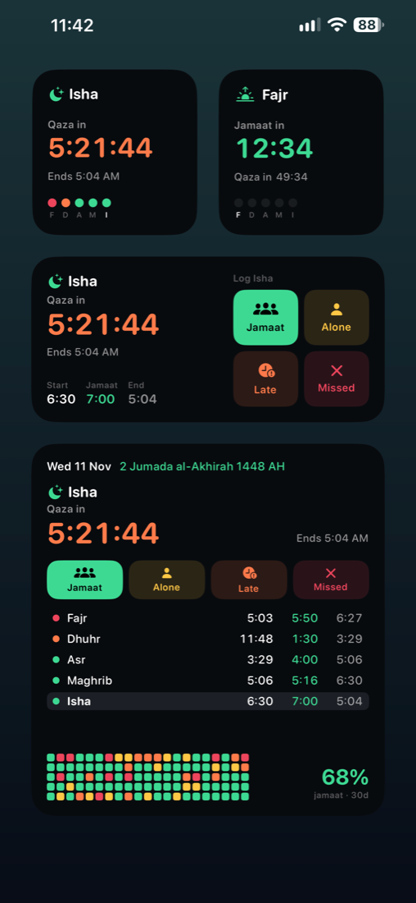
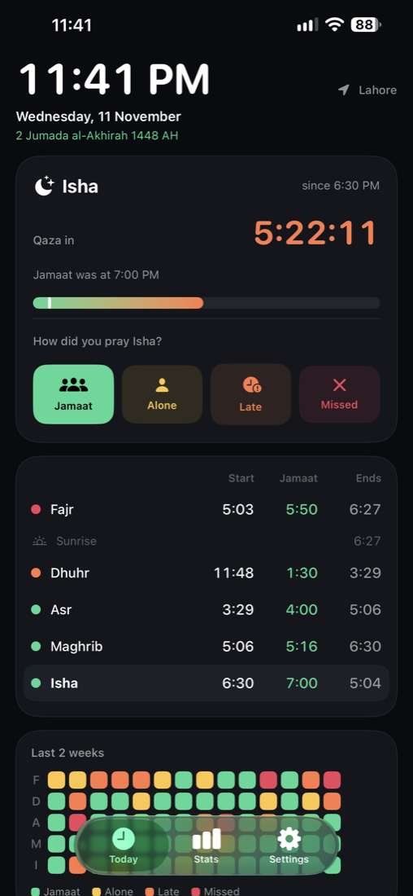
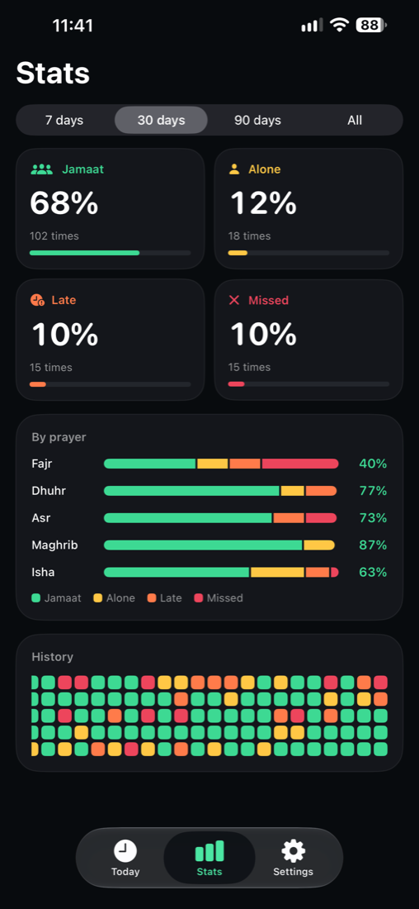
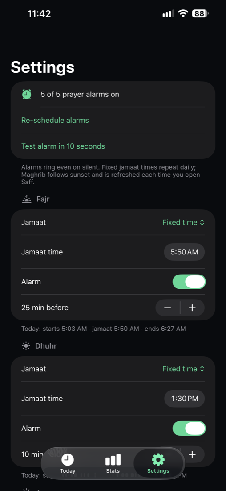

# Saff

A minimal, dark prayer tracker for iPhone, with jamaat alarms and widgets you can log prayers from without opening the app.

*Saff* (صف) means the row worshippers stand in for congregational prayer.

| Widgets | Today | Stats | Settings |
|:---:|:---:|:---:|:---:|
|  |  |  |  |

<sub>Screenshots use generated sample data.</sub>

## Features

- **Three times per prayer.** Start and end are calculated offline. Jamaat is set by you, either as a fixed clock time (Asr at 4:00) or as minutes after the azan (Maghrib + 10, which follows sunset every day).
- **Log in one tap:** Jamaat, Alone, Late (qaza) or Missed. Tap the same button again to undo.
- **Live countdowns.** "Jamaat in 12:34" before jamaat, then "Qaza in 1:05:00" until the prayer's time ends.
- **Widgets:**
  - Small: countdown and today's dots.
  - Medium: countdowns, times and the log buttons.
  - Large: the date with Hijri, log buttons, today's timetable, a 3-week heatmap and jamaat %.
  - Lock screen: countdown, progress ring and an inline line.
- **Real alarms** through AlarmKit. They ring even on silent and play a custom sound. Each prayer has its own offset before jamaat, e.g. 10 minutes, or 25 for Fajr.
- **Stats** for 7, 30 or 90 days, or all time: percentage and count per status, a breakdown per prayer, and a history heatmap.
- **Hijri date** that moves forward at Maghrib, with a ±2 day adjustment for local moon sighting.
- **Fully offline.** No account, server or analytics. Data stays on the device, in an App Group shared with the widgets.

## Prayer times

- Calculated with [Adhan](https://github.com/batoulapps/adhan-swift) (MIT).
- Method: University of Islamic Sciences, Karachi. Asr: Hanafi.
- When each prayer ends:

  | Prayer | Ends at |
  |---|---|
  | Fajr | Sunrise |
  | Dhuhr | Asr |
  | Asr | Maghrib |
  | Maghrib | Isha |
  | Isha | Next Fajr |

- Location is currently fixed to **Lahore** (Asia/Karachi). To use another city, change `SaffLocation.lahore` in [`Models.swift`](Packages/SaffCore/Sources/SaffCore/Models.swift). The app assumes the phone's time zone matches the city's.

Fixed jamaat times are kept as you enter them. Mosques change them through the year, so the app flags a jamaat time in orange once it falls outside that prayer's window.

## Requirements

- iOS 26 or later; AlarmKit needs it.
- Xcode 27, and [XcodeGen](https://github.com/yonaskolb/XcodeGen) (`brew install xcodegen`).
- An Apple ID. A free account works, but apps signed with it expire after 7 days and need reinstalling. Your data is kept when you reinstall.

## Build and install

```bash
git clone <this repo> && cd saff
echo YOUR_TEAM_ID > scripts/team.txt     # Xcode → Settings → Accounts → your team
./scripts/install.sh                     # builds and installs on the iPhone connected by cable
```

The Xcode project is generated from [`project.yml`](project.yml). Run `xcodegen generate` if you want to open `Saff.xcodeproj` in Xcode.

**Building under your own Apple ID:** bundle IDs and App Groups are registered per developer. Replace `com.ahmadmujahid` with your own prefix in these places:
- `project.yml`
- both `.entitlements` files
- `Store.swift` (`appGroup`)
- `scripts/install.sh`

**Custom alarm sound (optional):** put a `.caf` file of 30 seconds or less at `Saff/Sounds/alarm.caf` before building. It's gitignored. Without it, alarms use the system alarm sound. To convert an mp3: `afconvert -f caff -d aac in.mp3 Saff/Sounds/alarm.caf`, trimming it first if it's longer than 30 s.

The first time you install on the iPhone:
1. Turn on **Settings → Privacy & Security → Developer Mode**.
2. After installing, trust the developer under **Settings → General → VPN & Device Management**.

## Project layout

```
Packages/SaffCore/   Shared logic: prayer schedule, jamaat rules, log store, stats, Hijri, theme
Saff/                The app: Today, Stats, Settings screens; AlarmKit scheduling
SaffWidgets/         Home and lock screen widgets
Shared/              App Intent used by the widget log buttons
scripts/             install.sh, app icon generator
```

To check the core logic on a Mac without a phone, run `cd Packages/SaffCore && swift run saffcheck`. It prints today's schedule.

## Known limitations

- Maghrib (and any "after azan" jamaat) alarms are scheduled 14 days ahead. Open the app at least once in that time; Settings shows how far ahead they're set.
- One fixed location. There is no GPS or calculation-method picker yet.
